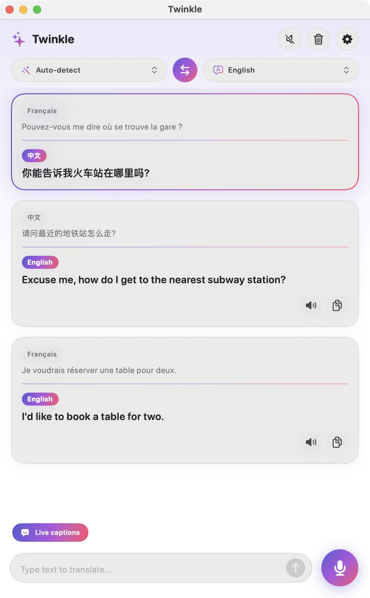
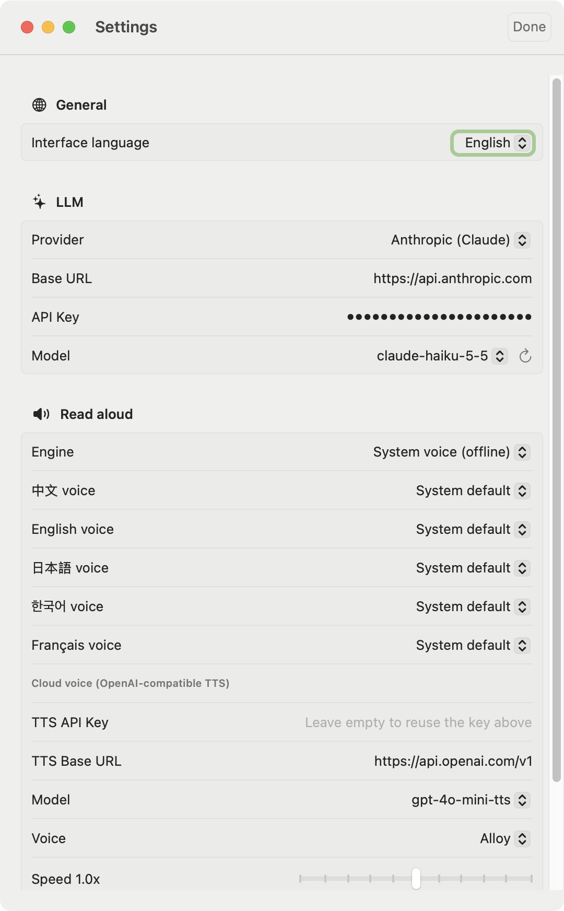

<div align="right"><b>English</b> | <a href="README.zh-CN.md">简体中文</a></div>

<p align="center">
  
</p>

<h1 align="center">Twinkle</h1>

<p align="center">
  AI-powered translator for <b>Mac, iPhone and Apple Watch</b>.<br/>
  Bilingual side-by-side results, live voice translation and live captions in<br/>
  Chinese · English · Japanese · Korean · French.
</p>

<p align="center">
  
  &nbsp;&nbsp;
  
</p>

## Features

- **Bilingual view** – the original and its translation sit together in one card, streamed token by token. Copy or read aloud with one tap.
- **5 translation languages** – Chinese, English, Japanese, Korean and French. Pick any source and target (or let **Auto-detect** choose the source), and swap them with one tap.
- **Live voice translation** (Mac / iPhone) – speak and see the translation appear while you talk.
- **Live captions** – turn on *Live captions* to listen continuously. Speech is split into sentences at natural pauses (~1.3 s) and each sentence is shown as its own bilingual card, original on top and translation below, with no gap in the audio.
- **Read aloud** – two engines, switchable in Settings:
  - *System voices* (offline): choose a specific voice per language, including Enhanced / Premium ones.
  - *OpenAI cloud TTS*: more natural voices; automatically falls back to system voices on failure.
  - Speed control and one-tap preview for both.
- **Bring your own LLM** – Anthropic (Claude) or any OpenAI-compatible API (OpenAI, DeepSeek, Qwen, local gateways…). After you enter an API key, the model list is fetched into a dropdown.
- **Interface language** – switch the app UI between 简体中文 and English in Settings, instantly, or follow the system.
- **Apple Watch** – dictate, scribble or type on the watch; LLM and read-aloud settings sync from the iPhone over WatchConnectivity.
- **Mac Universal** – runs natively on Apple Silicon (arm64) and Intel (x86_64).
- API keys are stored in the system **Keychain**.

## Requirements

| | Minimum |
|---|---|
| macOS | 14.0 |
| iOS | 17.0 |
| watchOS | 10.0 |
| Xcode | 16+ (developed with 26.2) |
| Tools | [XcodeGen](https://github.com/yonaskolb/XcodeGen) (`brew install xcodegen`) |

## Build & Run

```bash
brew install xcodegen
xcodegen generate          # generates Twinkle.xcodeproj from project.yml
open Twinkle.xcodeproj
```

1. In Xcode, select your **Team** for the `TwinkleMac`, `TwinkleiOS` and `TwinkleWatch` targets.
2. Change the bundle ID prefix (`com.twinkle`) in `project.yml` to your own reverse-domain, then re-run `xcodegen generate`.
3. Run the `TwinkleMac` scheme, or run `TwinkleiOS` on an iPhone (it embeds the Watch app).
4. Open **Settings** in the app, enter your API key and choose a model.

Command-line Mac build:

```bash
xcodebuild -project Twinkle.xcodeproj -scheme TwinkleMac -configuration Release \
  -destination 'generic/platform=macOS' CODE_SIGNING_ALLOWED=NO build
```

The result is a Universal binary (`x86_64 arm64`). iOS / watchOS builds require the matching platform components (Xcode ▸ Settings ▸ Components).

## Usage

- **Text** – type in the box and press Return. Choose the source (or *Auto-detect*) and target languages at the top; the ⇄ button swaps them.
- **Voice** – tap the microphone to speak, tap again to stop.
- **Live captions** – turn on the *Live captions* pill, then tap the microphone. Every sentence appears as it is finished, while the sentence being spoken is previewed live. Tap the microphone again to stop.

## Configuration

| Setting | Notes |
|---|---|
| Interface language | Follow system, 简体中文 or English |
| Provider | Anthropic, or OpenAI-compatible |
| Base URL | Defaults: `https://api.anthropic.com` / `https://api.openai.com/v1` |
| API Key | Stored in Keychain |
| Model | Fetched from `GET /v1/models` (Anthropic) or `GET /models` (OpenAI-compatible); falls back to manual entry if unavailable |
| Read-aloud engine | System voices (one voice per language) or OpenAI TTS (`/audio/speech`); a TTS key left empty reuses the OpenAI-compatible LLM key |

## Project structure

```
project.yml            XcodeGen spec (3 targets)
Shared/Core/           Shared by Mac, iOS and Watch
                       TranslationClient (streaming LLM), TranslatorViewModel,
                       Models (languages + detection), AppSettings, TTSSettings,
                       Speaker, UILanguage (runtime UI localization), Keychain,
                       WatchSync, Theme, EntryCard
Shared/Speech/         SpeechInput – real-time recognition with auto sentence splitting (Mac + iOS)
Shared/UI/             TranslatorView, SettingsView (Mac + iOS)
Shared/Resources/      Localizable.strings / InfoPlist.strings (zh-Hans, en)
Mac/  iOS/  Watch/     App entry points, asset catalogs (app icon); Watch also has WatchView
docs/                  Logo (SVG) and screenshots
```

## Notes & limitations

- Voice input must pick its language before you speak. With *Auto-detect* as source the microphone assumes Chinese (or English when the target is Chinese); choose the source language explicitly for other languages.
- Live captions rely on Apple's speech recognizer, which ends a task after roughly a minute or on long silence; Twinkle restarts it automatically. Very short pauses may not split sentences, and accuracy depends on the language and environment.
- The Watch has no direct speech-recognition API; it relies on the system dictation in the text field, and needs the paired iPhone (or Wi-Fi) for network access.
- Speech recognition uses Apple's Speech framework and may send audio to Apple, depending on the language and device.
- Development builds are ad-hoc signed on Mac; re-signing changes the identity, so the Keychain may ask for permission again. Use a stable developer signing identity to avoid this.
- Status: the Mac app builds and runs. The iOS and watchOS sources type-check, but the apps have not yet been run on a simulator or device, so iPhone voice input, Watch dictation and phone→watch sync are untested. Live captions have been verified at the UI level only; end-to-end behaviour with a real microphone is untested.
- Only the interface language options 简体中文 / English exist so far; translation itself supports all five languages.

## Development

Debug builds accept demo launch arguments used to generate the screenshots, which never touch your Keychain or settings:

```bash
Twinkle.app/Contents/MacOS/Twinkle -demo -uiLang en          # main window with sample data
Twinkle.app/Contents/MacOS/Twinkle -demoSettings -uiLang zh-Hans   # settings only
```

The logo is drawn programmatically (see `docs/logo.svg` for the vector source).

## License

[MIT](LICENSE) © 2026 HackSmith
