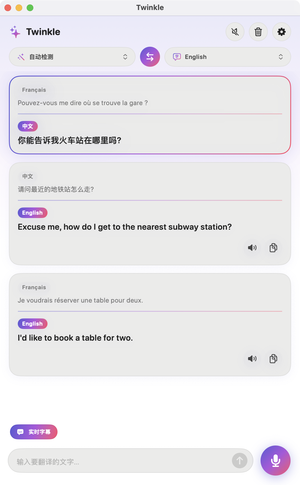
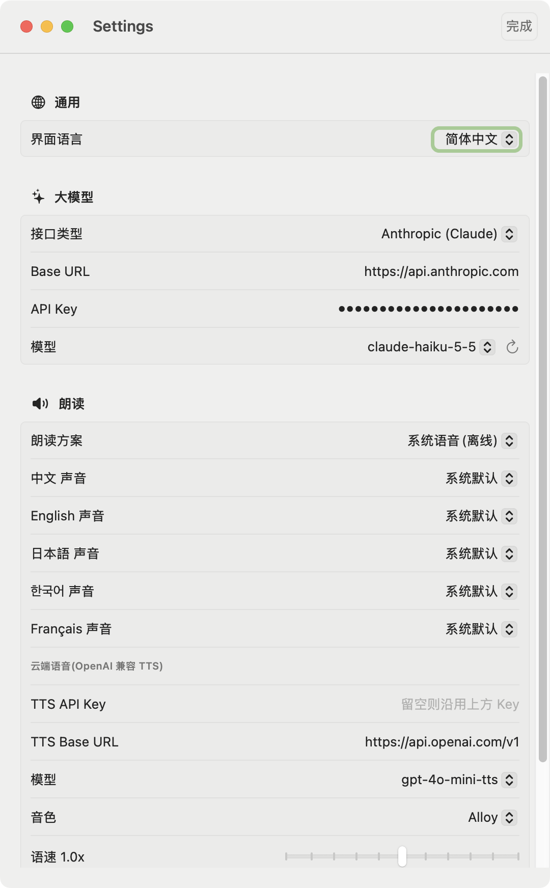

<div align="right"><a href="README.md">English</a> | <b>简体中文</b></div>

<p align="center">
  
</p>

<h1 align="center">Twinkle</h1>

<p align="center">
  基于 AI 大模型的翻译 App,支持 <b>Mac、iPhone 和 Apple Watch</b>。<br/>
  双语对照、实时语音翻译、实时字幕,<br/>
  支持 中文 · English · 日本語 · 한국어 · Français。
</p>

<p align="center">
  
  &nbsp;&nbsp;
  
</p>

## 功能

- **双语对照**:原文与译文同卡片展示,译文流式逐字输出,一键复制或朗读。
- **5 种翻译语言**:中文、英文、日语、韩语、法语。源语言和目标语言任意选择(源语言也可设为**自动检测**),一键互换。
- **实时语音翻译**(Mac / iPhone):边说边出译文。
- **实时字幕**:打开「实时字幕」后持续聆听,按自然停顿(约 1.3 秒)自动分句,每一句单独显示为一张双语卡片(原文在上、译文在下),音频不中断、不丢字。
- **朗读译文**:两种方案,可在设置中切换:
  - *系统语音*(离线):每种语言可单独选择具体声音,包含增强、高级音质。
  - *OpenAI 云端语音*:音色更自然,失败时自动退回系统语音。
  - 两种方案都支持语速调节和一键试听。
- **自带大模型**:支持 Anthropic(Claude)或任何 OpenAI 兼容接口(OpenAI、DeepSeek、通义、本地网关等)。输入 API Key 后自动拉取模型列表,以下拉菜单选择。
- **界面语言**:设置中可即时切换简体中文 / English,或跟随系统。
- **Apple Watch**:在手表上听写、手写或键盘输入;大模型与朗读配置通过 WatchConnectivity 从 iPhone 同步。
- **Mac 通用二进制**:原生支持 Apple 芯片(arm64)和 Intel(x86_64)。
- API Key 保存在系统**钥匙串**中。

## 环境要求

| | 最低版本 |
|---|---|
| macOS | 14.0 |
| iOS | 17.0 |
| watchOS | 10.0 |
| Xcode | 16+(开发环境 26.2) |
| 工具 | [XcodeGen](https://github.com/yonaskolb/XcodeGen)(`brew install xcodegen`) |

## 构建与运行

```bash
brew install xcodegen
xcodegen generate          # 根据 project.yml 生成 Twinkle.xcodeproj
open Twinkle.xcodeproj
```

1. 在 Xcode 中为 `TwinkleMac`、`TwinkleiOS`、`TwinkleWatch` 三个 target 选择你的 **Team**。
2. 把 `project.yml` 里的 Bundle ID 前缀(`com.twinkle`)改成你自己的反向域名,然后重新执行 `xcodegen generate`。
3. 运行 `TwinkleMac` scheme,或把 `TwinkleiOS` 装到 iPhone(它会内嵌 Watch App)。
4. 在 App 的**设置**中填入 API Key 并选择模型。

命令行构建 Mac 版:

```bash
xcodebuild -project Twinkle.xcodeproj -scheme TwinkleMac -configuration Release \
  -destination 'generic/platform=macOS' CODE_SIGNING_ALLOWED=NO build
```

产物为通用二进制(`x86_64 arm64`)。构建 iOS / watchOS 需要先在 Xcode ▸ Settings ▸ Components 中安装对应平台组件。

## 使用方法

- **文字翻译**:在输入框输入后按回车。顶部选择源语言(或「自动检测」)和目标语言,中间的 ⇄ 按钮可互换。
- **语音翻译**:点击麦克风开始说话,再点一次停止。
- **实时字幕**:先打开「实时字幕」,再点击麦克风。每说完一句就会生成一张卡片,正在说的那一句会实时预览;再次点击麦克风结束。

## 配置说明

| 配置项 | 说明 |
|---|---|
| 界面语言 | 跟随系统、简体中文或 English |
| 接口类型 | Anthropic,或 OpenAI 兼容 |
| Base URL | 默认 `https://api.anthropic.com` / `https://api.openai.com/v1` |
| API Key | 保存在钥匙串 |
| 模型 | 通过 `GET /v1/models`(Anthropic)或 `GET /models`(OpenAI 兼容)获取;获取失败时可手动输入 |
| 朗读方案 | 系统语音(每种语言单独选声音),或 OpenAI TTS(`/audio/speech`);TTS Key 留空时沿用 OpenAI 兼容的 LLM Key |

## 项目结构

```
project.yml            XcodeGen 配置(3 个 target)
Shared/Core/           Mac、iOS、Watch 共用
                       TranslationClient(流式 LLM)、TranslatorViewModel、
                       Models(语言与检测)、AppSettings、TTSSettings、
                       Speaker、UILanguage(运行时界面本地化)、Keychain、
                       WatchSync、Theme、EntryCard
Shared/Speech/         SpeechInput:实时语音识别与自动分句(Mac + iOS)
Shared/UI/             TranslatorView、SettingsView(Mac + iOS)
Shared/Resources/      Localizable.strings / InfoPlist.strings(zh-Hans、en)
Mac/  iOS/  Watch/     各端入口与资源目录(含应用图标);Watch 另含 WatchView
docs/                  Logo(SVG)与截图
```

## 注意事项与限制

- 语音输入必须在开口前确定语言。源语言为「自动检测」时,麦克风默认按中文识别(目标语言是中文时按英文识别);说其他语言请显式选择源语言。
- 实时字幕依赖 Apple 的语音识别器,它在约一分钟或长时间静音后会结束任务,Twinkle 会自动重启。很短的停顿可能不会断句,识别准确度取决于语言和环境。
- Watch 没有直接可用的语音识别接口,依赖输入框的系统听写;联网需要配对的 iPhone(或 Wi-Fi)。
- 语音识别使用 Apple Speech 框架,视语言和设备不同,音频可能会发送到 Apple 处理。
- Mac 开发版使用 ad-hoc 签名,重新签名会改变身份,钥匙串可能再次请求授权。使用稳定的开发者签名即可避免。
- 当前状态:Mac 版可以构建并运行;iOS 和 watchOS 的源码已通过类型检查,但尚未在模拟器或真机上运行,iPhone 语音输入、Watch 听写、手机到手表的配置同步均未实测。实时字幕只验证了界面层面,使用真实麦克风的端到端效果尚未测试。
- 目前界面语言只有 简体中文 / English 两种;翻译本身支持全部五种语言。

## 开发

Debug 构建支持用于生成截图的演示启动参数,它们不会读写你的钥匙串或设置:

```bash
Twinkle.app/Contents/MacOS/Twinkle -demo -uiLang en               # 带示例数据的主窗口
Twinkle.app/Contents/MacOS/Twinkle -demoSettings -uiLang zh-Hans  # 仅设置页
```

Logo 由代码绘制,矢量源文件见 `docs/logo.svg`。

## 许可证

[MIT](LICENSE) © 2026 HackSmith
