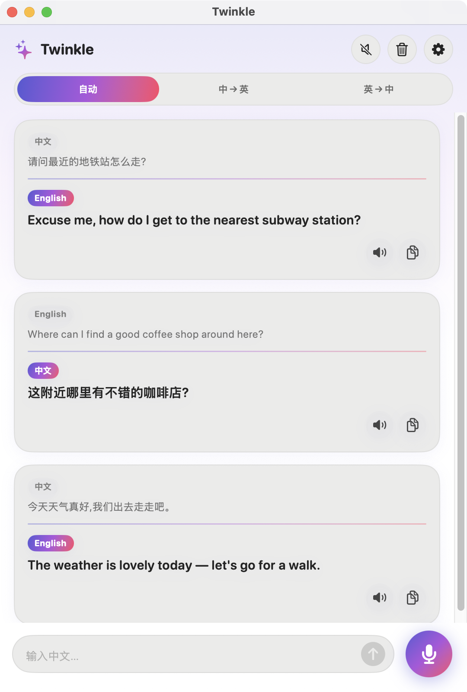
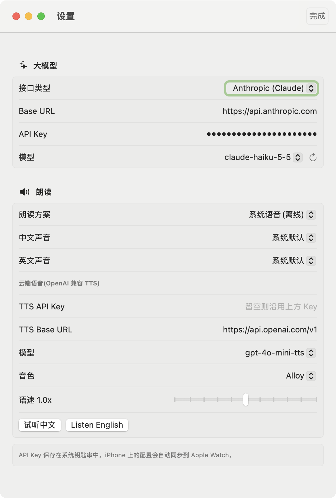

<div align="right"><a href="README.md">English</a> | <b>简体中文</b></div>

# ✨ Twinkle

基于 AI 大模型的中英互译 App,支持 **Mac、iPhone 和 Apple Watch**。结果以双语对照呈现(原文在上、译文在下),手机端支持实时语音互译。

## 界面截图

<p align="center">
  
  &nbsp;&nbsp;
  
</p>

<p align="center"><sub>左:双语对照翻译。右:设置页(大模型、模型下拉、朗读方案)。iPhone 版与 Mac 共用同一套 SwiftUI 界面。</sub></p>

## 功能

- **双语对照**:原文与译文同卡片展示,译文流式逐字输出。
- **方向控制**:自动识别、中→英、英→中。
- **实时语音翻译**(Mac / iPhone):说中文或英文,边说边翻译(带防抖),说完后整句存入历史。
- **朗读译文**:两种方案,可在设置中切换:
  - *系统语音*(离线):可分别选择中文、英文的具体声音,包含增强、高级音质。
  - *OpenAI 云端语音*:音色更自然,失败时自动退回系统语音。
  - 两种方案都支持语速调节和一键试听。
- **自带大模型**:支持 Anthropic(Claude)或任何 OpenAI 兼容接口(OpenAI、DeepSeek、通义、本地网关等)。输入 API Key 后自动拉取模型列表,以下拉菜单选择,避免手输出错。
- **Apple Watch**:在手表上听写、手写或键盘输入;大模型与朗读配置通过 WatchConnectivity 从 iPhone 同步。
- **Mac 通用二进制**:同时支持 Apple 芯片(arm64)和 Intel(x86_64)。
- API Key 保存在系统**钥匙串**中。

## 环境要求

| | 最低版本 |
|---|---|
| macOS | 14.0 |
| iOS | 17.0 |
| watchOS | 10.0 |
| Xcode | 16+(开发环境 26.2) |
| 工具 | [XcodeGen](https://github.com/yonaskolb/XcodeGen)(`brew install xcodegen`) |

## 构建与运行

```bash
brew install xcodegen
xcodegen generate          # 根据 project.yml 生成 Twinkle.xcodeproj
open Twinkle.xcodeproj
```

1. 在 Xcode 中为 `TwinkleMac`、`TwinkleiOS`、`TwinkleWatch` 三个 target 选择你的 **Team**。
2. 把 `project.yml` 里的 Bundle ID 前缀(`com.twinkle`)改成你自己的反向域名,然后重新执行 `xcodegen generate`。
3. 运行 `TwinkleMac` scheme,或把 `TwinkleiOS` 装到 iPhone(它会内嵌 Watch App)。
4. 在 App 的**设置**中填入 API Key 并选择模型。

命令行构建 Mac 版:

```bash
xcodebuild -project Twinkle.xcodeproj -scheme TwinkleMac -configuration Release \
  -destination 'generic/platform=macOS' CODE_SIGNING_ALLOWED=NO build
```

产物为通用二进制(`x86_64 arm64`)。构建 iOS / watchOS 需要先在 Xcode ▸ Settings ▸ Components 中安装对应平台组件。

## 配置说明

| 配置项 | 说明 |
|---|---|
| 接口类型 | Anthropic,或 OpenAI 兼容 |
| Base URL | 默认 `https://api.anthropic.com` / `https://api.openai.com/v1` |
| API Key | 保存在钥匙串 |
| 模型 | 通过 `GET /v1/models`(Anthropic)或 `GET /models`(OpenAI 兼容)获取;获取失败时可手动输入 |
| 朗读方案 | 系统语音,或 OpenAI TTS(`/audio/speech`);TTS Key 留空时沿用 OpenAI 兼容的 LLM Key |

## 项目结构

```
project.yml            XcodeGen 配置(3 个 target)
Shared/Core/           Mac、iOS、Watch 共用
                       TranslationClient(流式 LLM)、TranslatorViewModel、
                       AppSettings、TTSSettings、Speaker、Keychain、WatchSync、
                       Theme、EntryCard
Shared/Speech/         SpeechInput:实时语音识别(Mac + iOS)
Shared/UI/             TranslatorView、SettingsView(Mac + iOS)
Mac/  iOS/  Watch/     各端入口(Watch 另含 WatchView)
```

## 注意事项与限制

- 语音输入必须在开口前确定语言,因此「自动」模式下麦克风默认按中文识别;说英文请切换到**英→中**。
- Watch 没有直接可用的语音识别接口,依赖输入框的系统听写;联网需要配对的 iPhone(或 Wi-Fi)。
- 语音识别使用 Apple Speech 框架,视语言和设备不同,音频可能会发送到 Apple 处理。
- Mac 开发版使用 ad-hoc 签名,重新签名会改变身份,钥匙串可能再次请求授权。使用稳定的开发者签名即可避免。
- 当前状态:Mac 版可以构建并启动;iOS 和 watchOS 的源码已通过类型检查,但尚未在模拟器或真机上运行,语音输入、Watch 听写、手机到手表的配置同步均未实测。

## 许可证

尚未选择许可证,公开发布前请先补充。
